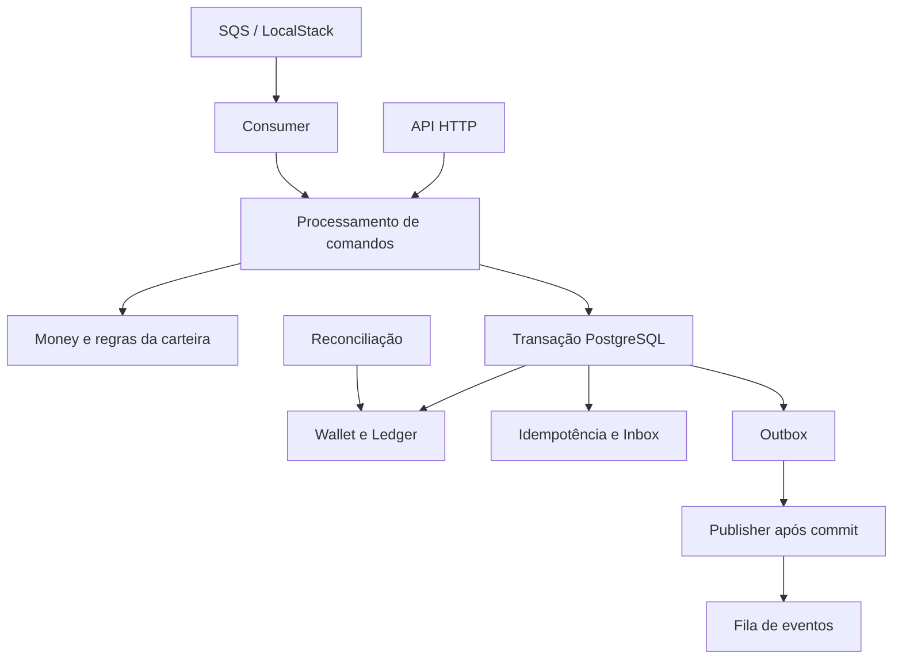

# Transactional Wallet

Backend de carteira transacional com precisão monetária, idempotência persistente e processamento assíncrono com Inbox e Transactional Outbox.

O projeto explora como manter saldo, histórico de movimentações e eventos coerentes quando solicitações se repetem, mensagens chegam fora de ordem ou a fila fica temporariamente indisponível.

**Stack:** TypeScript · NestJS · Bun · MikroORM · PostgreSQL · Amazon SQS · LocalStack · Decimal.js

> **Status:** protótipo de portfólio em refinamento. Há cenários de integração aprovados para Inbox, Outbox e reversões. A reprodução integral da suíte em ambiente limpo ainda é uma prioridade.

## O problema

Uma operação financeira não termina na atualização de um saldo. Ela precisa deixar um histórico consistente, lidar com tentativas repetidas e permitir que integrações retomem o processamento após uma falha.

O Transactional Wallet estuda quatro situações principais:

- A mesma solicitação é enviada mais de uma vez.
- Duas operações disputam o saldo da mesma carteira.
- O banco confirma uma movimentação enquanto a fila está indisponível.
- Uma reversão chega antes da operação que ela referencia.

## Funcionalidades

| Recurso | Finalidade |
| --- | --- |
| Carteiras e movimentações | Registrar débitos e créditos com validação de saldo e moeda |
| Money | Representar valores com precisão decimal e serialização em string |
| Ledger | Manter o histórico de lançamentos associado às movimentações |
| Idempotência persistente | Identificar repetições por provedor e chave, com verificação do hash do payload |
| Inbox | Persistir o controle de mensagens recebidas para evitar efeitos repetidos |
| Transactional Outbox | Registrar eventos na transação da movimentação e publicá-los após o commit |
| REFUND e ROLLBACK | Tratar referências, compensações e tentativas repetidas de reversão |
| Reconciliação | Detectar divergências entre o saldo e o histórico de lançamentos |

## Operações do domínio

O modelo utiliza os seguintes comandos:

| Comando | Papel |
| --- | --- |
| `BET` | Debitar o valor de uma aposta |
| `WIN` | Creditar o valor de um prêmio |
| `REFUND` | Solicitar estorno vinculado a uma operação anterior |
| `ROLLBACK` | Compensar o efeito de uma operação referenciada, conforme as regras do domínio |

As reversões preservam a referência à operação original. Uma compensação que deixaria a carteira com saldo negativo deve ser rejeitada. Referências ainda não encontradas podem permanecer em `PENDING_REFERENCE` para processamento posterior.

O escopo atual trabalha com valores de duas casas decimais. A validação de um código de moeda não implica suporte a todas as moedas ou às diferentes precisões previstas na ISO 4217.

## Arquitetura

O desenho abaixo representa a organização lógica pretendida para a edição de portfólio. Os limites dos módulos e das transações devem ser conferidos contra o código de cada versão publicada.

| Camada | Responsabilidade |
| --- | --- |
| Domínio | Valores monetários, invariantes da carteira e regras de reversão |
| Aplicação | Orquestração dos casos de uso, idempotência e unidade transacional |
| Infraestrutura | Persistência com MikroORM, bloqueios PostgreSQL e integração SQS |
| Entradas | Contratos HTTP e consumo de mensagens |

### Fluxo transacional

1. Validar o comando, o valor, a moeda e as referências.
2. Verificar a identidade da operação e a compatibilidade do payload com a chave idempotente.
3. Serializar as alterações da carteira com bloqueio de linha no PostgreSQL.
4. Persistir saldo, lançamentos, resultado idempotente e evento de Outbox na mesma transação. No consumo de mensagens, o registro de Inbox também deve ser atômico com o efeito de negócio.
5. Confirmar a transação antes de confirmar o consumo da mensagem.
6. Publicar os eventos pendentes da Outbox e registrar o sucesso do envio.

Os passos descrevem o contrato de consistência que a implementação e os testes devem sustentar.

## Decisões técnicas

### Precisão monetária

O objeto de valor `Money` utiliza Decimal.js e recebe valores monetários como strings decimais, por exemplo `"125.50"`. Isso evita depender da aritmética de ponto flutuante de `number` para os cálculos monetários.

### Idempotência no banco

A identificação por provedor e chave de idempotência é persistida. O hash do payload permite distinguir uma repetição equivalente da reutilização da mesma chave para uma solicitação diferente. Constraints no banco são parte da proteção contra concorrência; uma consulta anterior à gravação, isoladamente, não basta.

### Bloqueio por carteira

O uso de `SELECT FOR UPDATE` serializa operações que alteram a mesma carteira dentro da transação. A escolha favorece consistência do saldo, com o custo de contenção quando há muitas operações sobre a mesma carteira.

### Inbox e Transactional Outbox

A Inbox controla o processamento de mensagens recebidas. A Outbox desacopla a confirmação da movimentação da disponibilidade da fila, mantendo um evento pendente quando a publicação falha.

O desenho assume entrega **pelo menos uma vez**. Uma falha entre o envio e o registro da confirmação pode gerar reenvio. Consumidores precisam deduplicar eventos por uma identidade lógica estável; não há promessa de entrega exatamente uma vez de ponta a ponta.

### Reversões e reconciliação

As reversões usam movimentos compensatórios com referência à operação original. A reconciliação detecta divergências sem corrigir o saldo silenciosamente, permitindo investigação e reparo auditável.

## Tecnologias

| Tecnologia | Uso |
| --- | --- |
| TypeScript | Tipagem e implementação das regras e contratos |
| NestJS | Organização da aplicação e injeção de dependências |
| Bun | Ferramentas de execução, dependências e testes |
| MikroORM | Mapeamento e persistência de dados |
| PostgreSQL | Transações, constraints, bloqueios e armazenamento persistente |
| Amazon SQS | Contrato de mensageria assíncrona |
| LocalStack | Emulação local do SQS para desenvolvimento e testes |
| Decimal.js | Aritmética decimal dos valores monetários |

## Validação e testes

O registro de execução de **21/10/2026** contém nove cenários aprovados em `inbox-outbox-reversals.integration.test.ts`:

| Cenário | Resultado registrado |
| --- | --- |
| SQS indisponível | `BET` confirma Wallet, Ledger e Outbox |
| Mensagem entregue duas vezes | Um débito e um registro de Inbox |
| `REFUND` antes de `BET` | Referência pendente e resolução posterior pelo worker |
| Repetição de `REFUND` | Impede segundo estorno da mesma referência |
| `ROLLBACK` de `WIN` sem saldo suficiente | Rejeita compensação que negativaria a carteira |
| Repetição de `ROLLBACK` de `BET` | Restaura os fundos uma única vez |
| Divergência entre saldo e Ledger | Detecta a inconsistência sem correção silenciosa |
| Falha na publicação | Mantém evento na Outbox para nova tentativa |
| Publicação no LocalStack | Registra confirmação após envio bem-sucedido |

**Resultado da execução completa registrada:** 41 testes aprovados, 18 com falha e 1 pendente. As falhas de integração afetadas exibiram `42P01: relation "wallets" does not exist`. O cenário de abertura com saldo inicial e lançamento `OPENING` permaneceu pendente.

Esses resultados são históricos e não representam uma nova execução da versão atual. A validação no LocalStack também não substitui testes de integração na AWS.

## Execução local

O ambiente de desenvolvimento utiliza Bun, PostgreSQL e LocalStack com o serviço SQS.

Os comandos exatos de instalação, configuração, migrations, criação das filas, inicialização da API e dos workers ainda precisam ser documentados a partir do `package.json` e dos arquivos reais do repositório. Este README não presume nomes de scripts ou variáveis de ambiente ainda não conferidos.

Para concluir a reprodução local, a documentação deve permitir:

1. Instalar as dependências com as versões declaradas pelo projeto.
2. Configurar um banco de desenvolvimento e um banco de teste isolado.
3. Aplicar as migrations e preparar as filas locais.
4. Iniciar a API e os processos de consumo e publicação.
5. Executar toda a suíte a partir de um clone limpo.

## Roteiro de demonstração

1. Processar uma operação e repetir a mesma solicitação: conferir um único efeito no saldo e no Ledger.
2. Indisponibilizar o SQS: mostrar a movimentação confirmada e o evento pendente na Outbox.
3. Restaurar a fila: acompanhar a publicação do evento pendente.
4. Solicitar uma reversão e repeti-la: mostrar a compensação e a prevenção de duplicidade.
5. Executar a reconciliação com uma divergência preparada em dados de teste: mostrar sua detecção.

## Próximos passos

- [ ] Automatizar preparação do banco de teste e aplicação de migrations.
- [ ] Resolver o cenário `OPENING` ou formalizar abertura apenas com saldo zero.
- [ ] Reexecutar a suíte completa e associar a saída a um commit.
- [ ] Documentar e validar os comandos de instalação e execução.
- [ ] Ampliar a evidência de concorrência real e conflitos de idempotência no PostgreSQL.
- [ ] Validar quedas entre commit, envio do evento e confirmação.
- [ ] Formalizar regras de reversão, identidade de eventos e retenção da idempotência.
- [ ] Definir backoff, DLQ e procedimentos de reprocessamento.
- [ ] Acrescentar métricas de eventos pendentes, tentativas e divergências.

## Contexto e autoria

Desenvolvido por **Nicolay Padalko**. Iniciado como desafio técnico e organizado como projeto de portfólio para estudo de backend transacional, modelagem de domínio e recuperação de falhas.

O projeto demonstra decisões de engenharia e seus limites. Não há métricas publicadas de desempenho, disponibilidade ou operação em produção.
